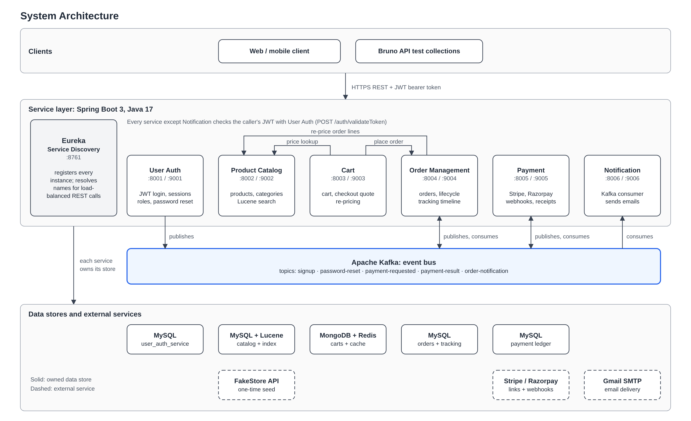

# Scaler Neovarsity Project Backend Specialization Master Repositories List

- [ServiceDiscoveryApplication](https://github.com/azneotec/ServiceDiscoveryApplication)
- [UserAuthService](https://github.com/azneotec/UserAuthService)
- [ProductCatalogService](https://github.com/azneotec/ProductCatalogService)
- [CartService](https://github.com/azneotec/CartService)
- [OrderManagementService](https://github.com/azneotec/OrderManagementService)
- [PaymentService](https://github.com/azneotec/PaymentService)
- [NotificationService](https://github.com/azneotec/NotificationService)

---

# Scaler Project: E-Commerce Backend

An e-commerce backend built as seven independently deployable Spring Boot microservices (Java 17). Customers can
register, search a catalogue, fill a cart, check out, pay online or on delivery, track an order and receive email
updates. Services find each other through Eureka, call each other over load-balanced REST and exchange events over
Apache Kafka. Each service owns its database.

This workspace holds all seven services side by side, plus the root `Makefile` and `docker-compose.yml` that run the
whole stack locally. Each service is its own Git repository and Maven project (see the list above); this workspace
root is not a repository itself.



## Services

| Service | Eureka name | Ports | Responsibility | Storage |
|---|---|---|---|---|
| [ServiceDiscoveryApplication](ServiceDiscoveryApplication) | n/a (the registry) | 8761 | Netflix Eureka server | none |
| [UserAuthService](UserAuthService) | `user-auth-service` | 8001, 9001 | Signup, login (JWT), token introspection, logout, password reset, admin role grant, session revocation | MySQL |
| [ProductCatalogService](ProductCatalogService) | `product-catalog-service` | 8002, 9002 | Products and categories, FakeStore seed data, typo-tolerant Lucene search, admin-only writes | MySQL + in-memory Lucene index |
| [CartService](CartService) | `cart-service` | 8003, 9003 | Per-user cart, checkout quote with re-pricing, order placement | MongoDB + Redis cache |
| [OrderManagementService](OrderManagementService) | `order-management-service` | 8004, 9004 | Orders, lifecycle state machine, tracking timeline, order history, payment orchestration | MySQL |
| [PaymentService](PaymentService) | `payment-service` | 8005, 9005 | Payment links (Stripe default, Razorpay alternative), signed webhooks, transaction log, receipts | MySQL |
| [NotificationService](NotificationService) | `notification-service` | 8006, 9006 | Consumes Kafka messages and sends them as email through Gmail SMTP | none |

Every service except Eureka runs as two instances (the second on the 9xxx port) under one Eureka name, to show
client-side load balancing and Kafka consumer groups.

`DockerApplication` is a small Hello World Spring Boot app used to practise Docker. It is not part of the system.

## How the pieces talk

**Order flow.** `POST /cart/checkout/confirm` on CartService forwards the customer's token to OrderManagementService
(`POST /orders`). Cash-on-delivery orders are confirmed immediately. Online orders start as `PENDING_PAYMENT`:
OrderManagementService asks PaymentService for a payment link over Kafka, and PaymentService reports the outcome
when the gateway's webhook arrives.

**REST (resolved by Eureka name):**

| Caller | Callee | Purpose |
|---|---|---|
| ProductCatalogService, CartService, OrderManagementService, PaymentService | UserAuthService `POST /auth/validateToken` | Token introspection on each protected request |
| CartService, OrderManagementService | ProductCatalogService `GET /products/{id}` | Product existence and current price (the order re-prices every line) |
| CartService | OrderManagementService `POST /orders` | Place the order |

**Kafka topics** (created by the `kafka-init` job in `docker-compose.yml`):

| Topic | Partitions | Producer | Consumer |
|---|---|---|---|
| `signup` | 1 | UserAuthService | NotificationService |
| `password-reset` | 1 | UserAuthService | NotificationService |
| `payment-requested` | 3 | OrderManagementService | PaymentService |
| `payment-result` | 3 | PaymentService | OrderManagementService |
| `order-notification` | 1 | OrderManagementService, PaymentService | NotificationService |

**Design choices worth knowing:**

- Database per service; MySQL schemas are created only by Flyway and Hibernate just validates them.
- Only UserAuthService holds the JWT key. Sessions are stored as token hashes, so a token can be revoked before it expires.
- Prices are re-verified at every stage: CartService at checkout, then OrderManagementService again, which rejects a changed `expectedTotal` with 409.
- Kafka messages are published after the database commit and are best-effort. Cash-on-delivery orders work with PaymentService or NotificationService offline.
- Redis is a cache-aside copy of carts; if it is down, reads fall back to MongoDB.

## Tech stack

Java 17 · Spring Boot 3.3.3 (3.5.x for Eureka and NotificationService) · Spring Cloud Netflix Eureka and LoadBalancer ·
Spring Security with JJWT · Spring Data JPA, MongoDB and Redis · Flyway · MySQL 8.0 · MongoDB 7.0 · Redis 7.4 ·
Apache Kafka 4.3 (KRaft) · Apache Lucene 9.12 · Stripe and Razorpay SDKs · Gmail SMTP · Maven wrapper · Docker and
Docker Compose · JUnit 5, Mockito · Bruno API collections.

## Prerequisites

- JDK 17
- Docker with Compose v2 (for MySQL, MongoDB, Redis and Kafka)
- GNU Make, `curl`
- Maven is not needed; each service ships `./mvnw`

## Run the stack locally

```bash
make help     # list every target
make up       # infra, Eureka and two instances each of UserAuth, ProductCatalog, Cart and OrderManagement
make status   # what is running and what is registered in Eureka
make down     # stop the services, then the infrastructure
```

`make up` builds any jar that is out of date, then starts, in order:

1. MySQL, MongoDB, Redis and Kafka from `docker-compose.yml` (waits until healthy; also creates the Kafka topics and the empty MySQL databases).
2. Eureka on `:8761`.
3. Each service, waiting for `/actuator/health` to report `UP` before moving on.

The Makefile sets every environment variable itself and never reads a service's own `.env`, so nothing started here can
reach a remote database.

### PaymentService and NotificationService

These need credentials, so they are not part of a plain `make up`:

```bash
make payment STRIPE_API_KEY=sk_test_... [STRIPE_WEBHOOK_SECRET=whsec_...]   # :8005 and :9005
make notification GMAIL_PASSWORD=...                                        # :8006 and :9006
make up GMAIL_PASSWORD=...                                                  # NotificationService as part of up
```

`payment-1` / `payment-2` and `notification-1` / `notification-2` start a single instance. Stripe is the default
gateway; the Razorpay variables (`RAZORPAY_KEY_ID`, `RAZORPAY_KEY_SECRET`, `RAZORPAY_WEBHOOK_SECRET`) are only for
switching to it. Credentials are passed on the command line and never stored in the repository.

### Ports and endpoints

| What | Where |
|---|---|
| Eureka dashboard | http://localhost:8761 |
| MySQL | `localhost:3307` (root / password; 3307 because a host MySQL usually owns 3306, override with `MYSQL_PORT`) |
| MongoDB | `localhost:27017` (root / password) |
| Redis | `localhost:6379` |
| Kafka | `localhost:9092` |
| Kafka UI | http://localhost:8090 |

The root `docker-compose.yml` and `NotificationService/docker-compose.yml` both bind Kafka's 9092, so run only one
at a time.

### Other useful targets

| Target | What it does |
|---|---|
| `make logs` | Follow the logs of every running service |
| `make build` | Rebuild all jars (tests skipped) |
| `make stop` | Stop the services but keep the infrastructure running |
| `make infra-reset` | Stop the infrastructure and delete its data volumes |
| `make clean` | Stop the services and delete `.run/` (logs, pid files, the generated JWT key) |
| `make docker-build` | Build a Docker image for every service (`docker-build-<service>` for one) |

PID files, logs and the generated JWT signing key live in `.run/`, which is gitignored. Delete
`.run/jwt.secret` to rotate the key; existing tokens then stop working.

## Try it

Every service ships a [Bruno](https://www.usebruno.com) collection in its `bruno/` folder. A typical walkthrough:

1. Sign up and log in with UserAuthService (`POST /auth/signup`, `POST /auth/login`) to get a bearer token.
2. Browse or search products on ProductCatalogService (reads are public).
3. Add items to the cart (`POST /cart/items`), quote it (`POST /cart/checkout`), then place the order (`POST /cart/checkout/confirm`).
4. Follow the order on OrderManagementService; pay through the link in the order for online payments.

Each service's `README.md` documents its endpoints, configuration and standalone run options.

## Tests

Each service has its own suite (JUnit 5, Mockito, `@WebMvcTest`; integration tests are tagged):

```bash
cd UserAuthService && ./mvnw test
```

## Documentation

| Where | What |
|---|---|
| `<Service>/README.md` | API, configuration and run instructions per service |
| [GLOSSARY-MAP.md](GLOSSARY-MAP.md) | Domain terms per context and the relationships between services |
| [project-report/](project-report) | The full project report: requirements, class and ER diagrams, schema design, checkout feature, AWS deployment and technologies. Start at `2026-10-24-00-index.md`, or open `Azad_Scaler_Neovarsity_Project_Report.pdf` |
| [docs/agents/](docs/agents) | Conventions for the AI-assisted workflow (issue tracker, triage labels, domain docs). See also [CLAUDE.md](CLAUDE.md) |

## Known limitations

- No refunds: a payment that lands on a cancelled order is logged for manual refund.
- No transactional outbox: if Kafka is down when an online order is placed, its payment request is lost.
- No idempotency key: two simultaneous confirm requests can create two orders.
- Currency is fixed to INR.
- NotificationService logs and drops send failures (no retry or dead-letter topic).
- No API gateway, circuit breaker, distributed tracing or centralised logging, and no CI pipeline.
- Development-only secrets in config (the seeded admin, the default JWT key) must be replaced outside local use.

## Author

Azad Asanali, for the Scaler Neovarsity Backend Specialization project (MSc Computer Science, Scaler Neovarsity – Woolf).
